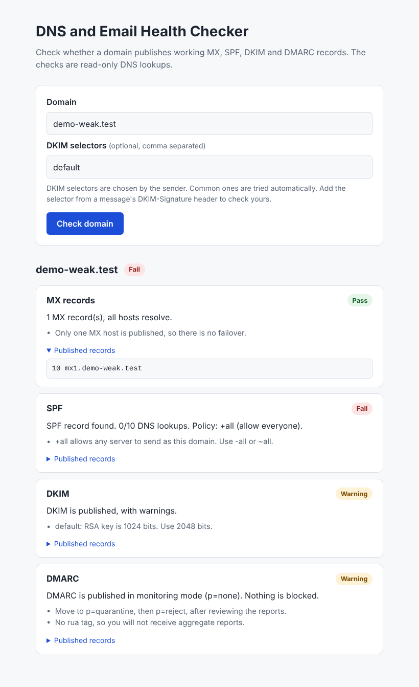

# DNS and Email Health Checker

A small web app that checks whether a domain publishes working **MX, SPF, DKIM and DMARC** records, and explains each problem in plain language. The API is built with Python and FastAPI, the interface with Next.js and TypeScript.



*Screenshots in this repository were taken against a local demo DNS zone (`demo-weak.test`, see [Try it offline](#try-it-offline)), not against real domains.*

## The problem

Mail that fails authentication ends up in spam or is rejected, and most causes are small DNS mistakes: two SPF records, more than 10 SPF lookups, a DMARC policy left on `p=none`, a revoked DKIM key. They are easy to introduce and hard to see. This tool runs the standard checks for a domain and returns a pass, warning or fail for each, with the reason and the fix..

## What it checks

| Check | What is verified |
| --- | --- |
| **MX** | Records exist, hosts resolve to an address, null MX, implicit-MX fallback, single point of failure |
| **SPF** | Exactly one record, DNS lookup budget (limit 10, RFC 7208) counted through `include` and `redirect`, loops and missing includes, the final `all` policy, deprecated `ptr` |
| **DKIM** | Selector records for common selectors plus selectors you supply, valid base64 and public key, revoked keys, RSA key size (warns below 2048 bits), Ed25519 length |
| **DMARC** | One record, valid `p` policy, `pct` below 100, `sp` validity, missing `rua` reports |

The overall result is the worst of the four. Every lookup is a read-only DNS query.

## Quick start with Docker

```bash
cp .env.example .env
docker compose up --build
```

Open <http://localhost:8080>. Caddy serves the web app and forwards `/api/*` to the API on the same origin. Set `SITE_ADDRESS` in `.env` to a real domain name to get automatic HTTPS.

## Local development

Backend (Python 3.12 or newer):

```bash
cd backend
python -m venv .venv && source .venv/bin/activate   # Windows: .venv\Scripts\activate
pip install -r requirements-dev.txt
uvicorn app.main:app --reload                       # http://localhost:8000/docs
```

Frontend (Node 20):

```bash
cd frontend
cp .env.example .env.local
npm install
npm run dev                                         # http://localhost:3000
```

## Try it offline

A demo DNS server with three made-up domains lets you run everything without internet access:

```bash
cd backend
python -m dev.demo_dns                              # terminal 1
DNS_NAMESERVERS=127.0.0.1 DNS_PORT=5353 uvicorn app.main:app   # terminal 2
```

Then check `demo-good.test` (all pass), `demo-weak.test` or `demo-broken.test`.

## API

`POST /api/check`

```bash
curl -s -X POST http://localhost:8000/api/check \
  -H 'Content-Type: application/json' \
  -d '{"domain": "example.com", "dkim_selectors": ["selector1"]}'
```

```json
{
  "domain": "example.com",
  "overall": "warn",
  "checks": [
    {
      "id": "dmarc",
      "title": "DMARC",
      "status": "warn",
      "summary": "DMARC is published in monitoring mode (p=none). Nothing is blocked.",
      "details": ["Move to p=quarantine, then p=reject, after reviewing the reports."],
      "records": ["v=DMARC1; p=none"]
    }
  ]
}
```

(The real response contains all four checks, in the order `mx`, `spf`, `dkim`, `dmarc`.)

| Status | Meaning |
| --- | --- |
| 200 | Checks ran. Individual checks that could not finish report `warn` instead of failing the request |
| 404 | The domain does not exist in DNS (NXDOMAIN) |
| 422 | Invalid input: IP address, malformed domain, bad selector, too many selectors |
| 429 | Rate limit reached. `Retry-After` is set |
| 502 | DNS resolution itself failed |

Interactive documentation is served at `/docs`. `GET /health` returns `{"status": "ok"}`.

## Configuration

| Variable | Default | Purpose |
| --- | --- | --- |
| `RATE_LIMIT_PER_MINUTE` | `20` | Requests per client per minute |
| `DNS_TIMEOUT_SECONDS` | `3` | Timeout for each DNS query |
| `DNS_NAMESERVERS` | system resolver | Comma separated resolvers, for example `1.1.1.1,9.9.9.9` |
| `DNS_PORT` | `53` | Resolver port, used by the offline demo |
| `TRUST_PROXY_HEADERS` | `false` | Use `X-Forwarded-For` as the client address. Only enable behind a proxy you control (the compose file does) |
| `CORS_ORIGINS` | `http://localhost:3000` | Browser origins allowed to call the API. Not needed behind Caddy |
| `SITE_ADDRESS` | `:80` | Caddy site address. A domain name enables HTTPS |
| `HTTP_PORT` | `8080` | Host port for Caddy |
| `NEXT_PUBLIC_API_URL` | empty | API base URL for `npm run dev`. Empty means same origin |

## Tests

```bash
cd backend && pytest        # 97 tests, fails below 90% coverage
cd frontend && npm test     # API client tests
```

The backend suite covers each check, input validation, the rate limiter and the HTTP layer. The real `dnspython` adapter is tested against a small local DNS server (`backend/tests/dnsserver.py`), including multi-chunk TXT records, NXDOMAIN, SERVFAIL and an unreachable server, so no test needs the internet. GitHub Actions runs lint, tests, the frontend build and a Docker smoke test on every push.

## Design decisions

The short version. The full reasoning is in [docs/ARCHITECTURE.md](docs/ARCHITECTURE.md).

- **Checks depend on a small `Resolver` interface**, so they are plain functions that are easy to test with an in-memory fake.
- **A failed lookup is a warning, not an error.** One slow DNS query should not hide the other three results.
- **Input is validated and normalised** before it reaches DNS: IDN domains become punycode, IP addresses and reserved suffixes are rejected, selectors are restricted.
- **Rate limiting is in memory and per process.** It is simple and enough for a single instance. Several replicas would need a shared store such as Redis.

## Limitations

- DKIM selectors cannot be listed through DNS. The tool tries ten common selectors plus the ones you give it, so "not found" for common selectors is a warning, not proof that DKIM is missing.
- The SPF check analyses the record and its lookup budget. It does not evaluate whether a particular IP address would pass.
- No TLS (MTA-STS, DANE), BIMI or blocklist checks yet.
- DMARC is checked at the domain you enter. Subdomain inheritance from the organisational domain is noted but not followed.

## Development notes

This project was written with AI assistance (Claude, Anthropic) at the direction of the repository owner. The code, tests and documentation were generated in that process, and the test suite and browser checks described above were run against it. No users, production data or company code are involved.

No license has been chosen yet, so all rights are reserved by default.
