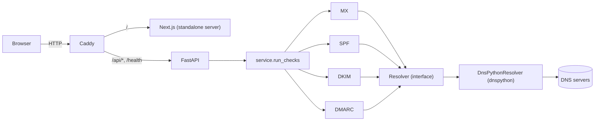

# Architecture

## Overview

There is no database. Each request is a handful of DNS queries and a response.

## Request flow

1. `POST /api/check` is received by FastAPI. Pydantic enforces the shape (domain length 3 to 253, at most 10 selectors).
2. The rate limiter is consulted using the client address.
3. `normalize_domain` and `normalize_selectors` clean the input. Failures become HTTP 422.
4. `run_checks` first asks the resolver whether the domain exists. NXDOMAIN becomes 404, a DNS outage becomes 502.
5. The four checks run in parallel threads. A `DNSLookupError` inside one check is turned into a `warn` result for that check only.
6. The overall status is the worst of the results, ignoring `info`.

## Key decisions

**A `Resolver` protocol between checks and DNS.** The checks only call `txt`, `mx`, `addresses` and `domain_exists`. In tests an in-memory `FakeResolver` supplies records. In production `DnsPythonResolver` wraps dnspython and maps its exceptions to one `DNSLookupError`. "Record does not exist" is an empty list, "the query failed" is an exception, and the two are never mixed.

**Testing the real adapter without the internet.** `tests/dnsserver.py` is a 60-line authoritative DNS server on localhost. The adapter tests run real queries against it, which covers the parts a fake cannot: TXT strings split into 255-character chunks (a 2048-bit DKIM key is longer than that), NXDOMAIN versus NODATA, SERVFAIL and timeouts. The same server powers the offline demo.

**SPF analysis follows RFC 7208 where it matters in practice.**
- Mechanisms `include`, `a`, `mx`, `ptr`, `exists` and the `redirect` modifier each count one lookup. `ip4`, `ip6` and `all` do not.
- `include` and `redirect` are followed recursively with a visited set, so loops are reported instead of hanging, and a depth limit stops pathological chains.
- An include whose target has no SPF record is reported as a failure, because receivers treat it as a permanent error.
- 8 or 9 lookups warn, more than 10 fail. A bare `all` is treated as `+all`.

**DKIM probing is concurrent.** Ten selectors are looked up in a small thread pool, so a slow resolver costs one timeout instead of ten. RSA key size is read with the `cryptography` library by parsing the published public key, not guessed from the string length.

**Statuses are an enum with four values.** `pass`, `warn`, `fail` and `info`. `info` is used for facts that are neither good nor bad, such as a null MX, so it does not change the overall result.

**Input validation.** Domains are lower-cased and converted to punycode with `idna`. The service rejects IP addresses, single labels, numeric top-level domains and reserved suffixes (`.local`, `.internal`, `.arpa` and others), so it cannot be used for reverse lookups or to probe internal names. Selectors are limited to a safe character set and a maximum count.

**Rate limiting.** A sliding-window limiter keyed by client address. It lives in process memory, which is simple and fast but not shared across workers or replicas. The client address comes from `X-Forwarded-For` only when `TRUST_PROXY_HEADERS=true`, because otherwise any client could pick its own key. Caddy replaces that header with the real client address.

**App factory.** `create_app(resolver, limiter, settings)` builds the application. Production uses the module-level `app`; tests pass fakes. This avoids global state and dependency-override tricks.

**Same-origin deployment.** Behind Caddy the browser calls `/api/check` on the page's own origin, so there is no CORS configuration in production. `NEXT_PUBLIC_API_URL` and CORS exist only for local development with two dev servers.

## Security notes

- The service performs DNS lookups only. It makes no HTTP requests to user-supplied hosts, so classic SSRF does not apply.
- The cost of abuse is DNS traffic and CPU, which is why input limits, short timeouts and the rate limiter exist.
- Containers run as non-root users. The API container has a read-only filesystem, drops all Linux capabilities and sets `no-new-privileges`.
- Dependencies are pinned in `requirements.txt` and `package-lock.json`.
- No secrets are needed or stored. `.env` is git-ignored and `.env.example` documents every setting.

## Known limitations and next steps

- Shared rate limiting (Redis) for multi-replica deployments.
- MTA-STS, TLS-RPT, BIMI and DNSBL checks.
- SPF evaluation for a given sender IP.
- Following DMARC inheritance from the organisational domain.
- Caching DNS answers for a short time to reduce repeated lookups.
